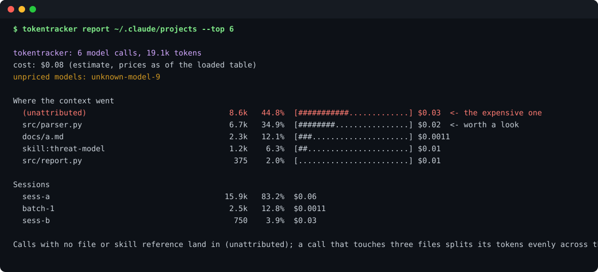

# tokentracker

**See where your agent sessions spend tokens: per session, per file, per skill.** Local only, no account, no network calls.

[](https://github.com/mgkvibez/tokentracker/actions/workflows/ci.yml)
[](LICENSE)
[](pyproject.toml)
[](https://github.com/mgkvibez/tokentracker/stargazers)



## Install

```bash
pipx install git+https://github.com/mgkvibez/tokentracker.git    # works today
pipx install tokentracker                                     # once the PyPI release is live
```

Standard library only. Nothing to configure, nothing to sign into.

## Three things it does

**1. Find the expensive thing in a session log.** Reads Claude Code's session JSONL, or any flat JSONL carrying a `usage` block:

```bash
tokentracker report ~/.claude/projects --top 6
```

That prints total tokens, estimated cost, the ranked list of what consumed context with percentages, and a per-session breakdown. A skill that eats 40% of a session is labelled as such instead of hiding in a 200-message transcript.

**2. Watch it while you work.** Same numbers, redrawn in place, so a runaway loop is visible in seconds rather than after the bill:

```bash
tokentracker watch ~/.claude/projects --interval 2
```

**3. Record usage you cannot read from logs.** If your harness keeps no logs, point the client's base URL at the proxy and work normally:

```bash
tokentracker proxy --port 8787 --upstream https://api.anthropic.com --log ~/.tokentracker/proxy.jsonl
tokentracker report ~/.tokentracker/proxy.jsonl
```

## Why it exists

Token burn is invisible until the invoice, and the invoice says "$41" rather than "the threat-model skill ate 40% of your context." Every harness records the numbers somewhere; almost nothing turns them into an answer you can act on. This does, locally, without shipping your transcripts to a dashboard.

## How it works

Three pieces, deliberately small:

- **Adapters** (`tokentracker/adapters.py`) turn a log line into an `Event`: session, model, usage, and the files or skills that call touched. Claude Code's JSONL is understood natively; anything else needs a flat `usage` block. Adding a harness is one function plus one fixture.
- **Attribution** (`tokentracker/attribute.py`) splits each call evenly across everything it touched, and puts a call that touched nothing into `(unattributed)`. That means the percentages always sum to 100% of real spend, and the honest answer for a call that read three files is "a third each" rather than a guess.
- **Cost** (`tokentracker/pricing.py`) is a data table, not code. The defaults are starting points stamped with the date they were written, `cache_read` is billed at 0.1x the input rate and `cache_write` at 1.25x, and an unknown model produces `cost: unavailable` instead of a fabricated number. Override the whole table with `--prices prices.json`.

Known limits, stated plainly: streamed responses are proxied but not counted, because usage arrives in fragments; and a call's tokens cannot be attributed more precisely than the tool calls inside it reveal.

## Contributing

`scripts/verify.sh` is the gate, and CI runs the same script on Python 3.9 and 3.12:

```bash
python3 -m pip install -e ".[dev]"
bash scripts/verify.sh
```

It checks install, that `pyproject.toml` and `__version__` agree, the full test suite, and that the CLI still produces a report. A new adapter needs a real log fixture, not a hand-written dict. See [CONTRIBUTING.md](CONTRIBUTING.md).

## License

MIT.
